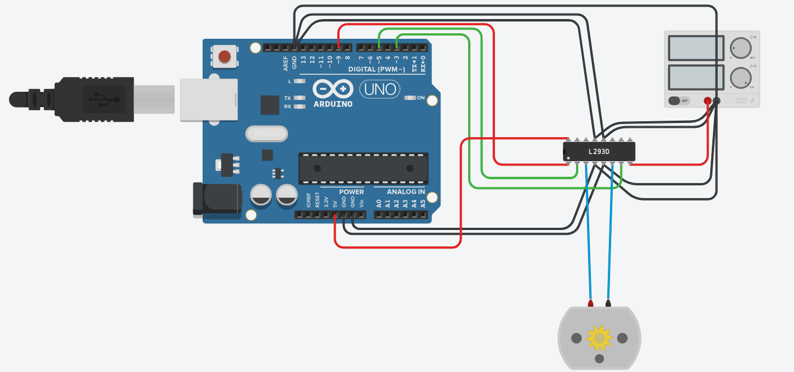

# L293D H-Bridge Motor Driver

Simulation of a DC motor control using the L293D integrated circuit and Arduino UNO.

## ⚙️ Features
- **Direction Control:** Logic signals (`HIGH`/`LOW`) on pins `1A` and `2A` change the motor's rotation direction.
- **Speed Control:** PWM (Pulse Width Modulation) on the `1,2EN` (Enable) pin regulates the motor speed.
- **Active Braking:** Setting both `1A` and `2A` to `HIGH` or `LOW` stops the motor instantly.

## 🔌 Pinout Connections
- **Arduino D5** -> L293D `1A` (Direction)
- **Arduino D6** -> L293D `2A` (Direction)
- **Arduino D9 (PWM)** -> L293D `1,2EN` (Speed)
- **L293D `1Y` and `2Y`** -> DC Motor terminals
- **VCC1 (Pin 16)** -> 5V (Logic power from Arduino)
- **VCC2 (Pin 8)** -> External Power Supply (Motor power)
- **GND** -> Common Ground for Arduino, L293D, and PSU.

## 📸 Simulation

## 💻 Arduino Code
The complete control logic is written in C++ and can be found in the `motor_control.ino` file. 

### Logic overview:
1. **Forward:** `1A` = HIGH, `2A` = LOW. PWM set to 200 (~80% speed).
2. **Stop:** `1A` = LOW, `2A` = LOW, PWM = 0.
3. **Backward:** `1A` = LOW, `2A` = HIGH. PWM set to 127 (~50% speed).
